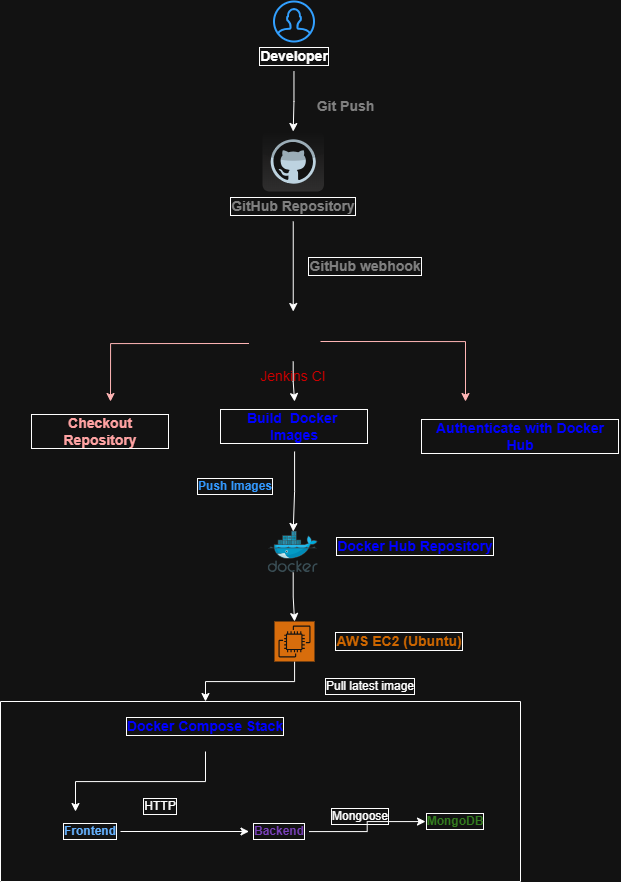
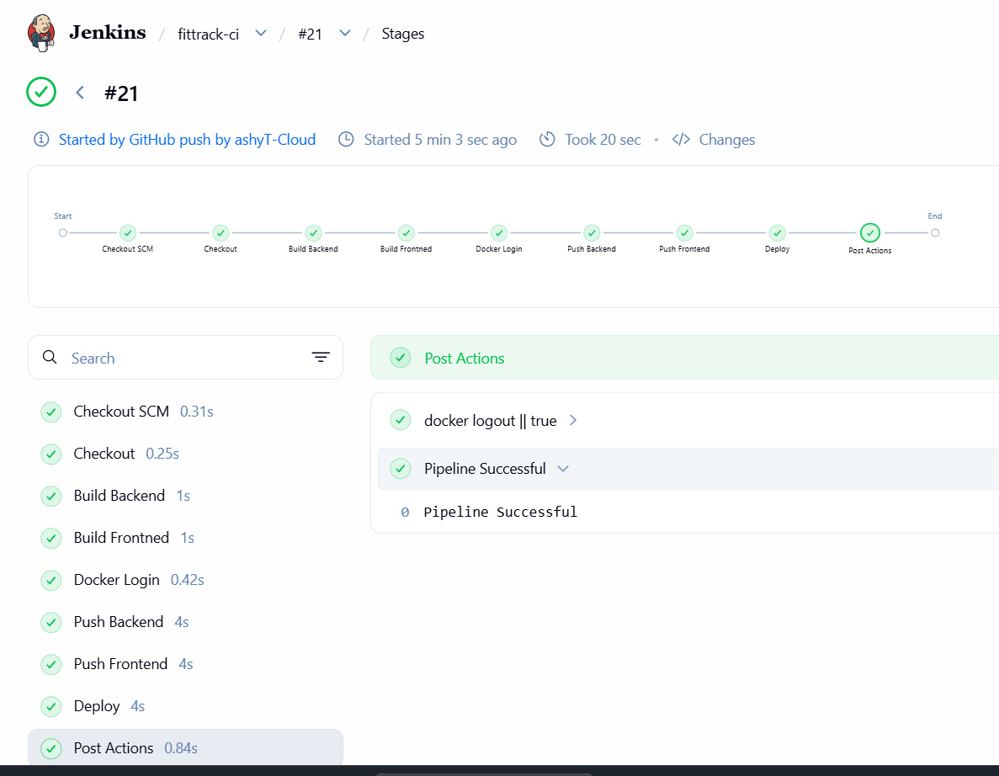
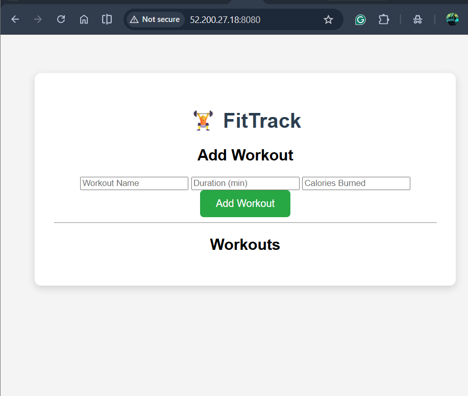
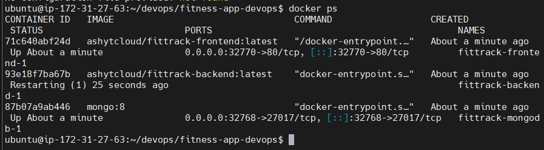
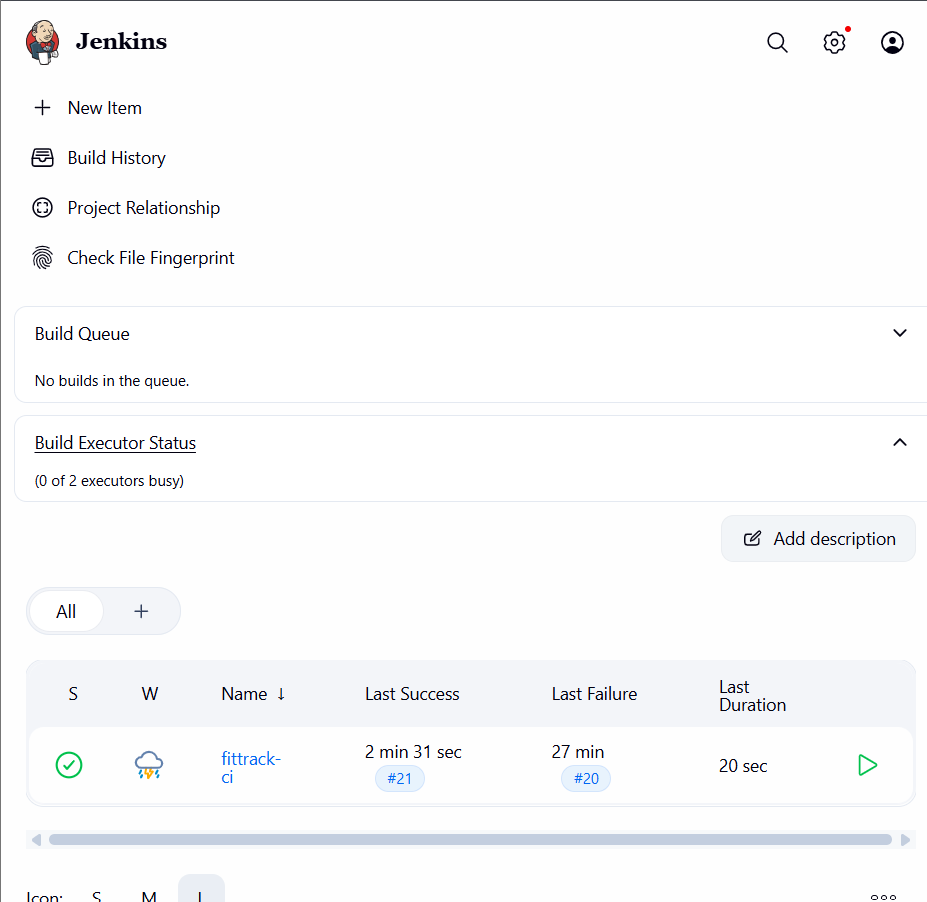
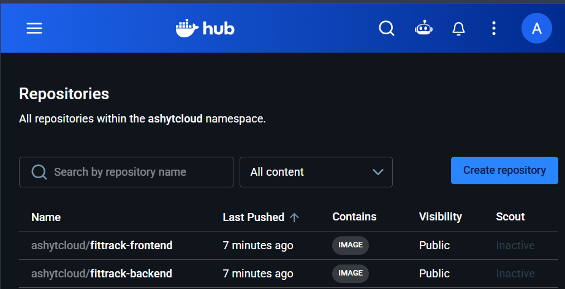

# FitTrack — Dockerized 3-Tier Fitness Application with CI/CD on AWS


FitTrack is a containerized three-tier fitness application built to demonstrate practical cloud and DevOps engineering skills. It combines a web frontend, a REST API, and a MongoDB database with Docker, Docker Compose, Nginx, and a Jenkins CI/CD pipeline.

The project covers application containerization, reverse proxy configuration, environment-based configuration, database connectivity, image publishing, and automated deployment workflows.

## Freelance Case Study

Explore the [FitTrack Dockerization Case Study](docs/CASE-STUDY.md) for
the deployment architecture, Docker Compose configuration, verification
results, and Dockerization and troubleshooting services demonstrated by
this personal portfolio project.

---

## Table of Contents

- [Project Overview](#project-overview)
- [Architecture](#architecture)
- [Technology Stack](#technology-stack)
- [Repository Structure](#repository-structure)
- [Features](#features)
- [Prerequisites](#prerequisites)
- [Local Deployment](#local-deployment)
- [Application Endpoints](#application-endpoints)
- [Jenkins CI/CD Pipeline](#jenkins-cicd-pipeline)
- [Environment and Security](#environment-and-security)
- [Verification and Troubleshooting](#verification-and-troubleshooting)
- [Screenshots](#screenshots)
- [Challenges and Lessons Learned](#challenges-and-lessons-learned)
- [Future Improvements](#future-improvements)
- [Author](#author)

---

## Project Overview

FitTrack demonstrates how a small full-stack application can be packaged and deployed using container-based DevOps practices.

The application consists of three main components:

1. **Frontend:** HTML, CSS, and JavaScript served by Nginx.
2. **Backend:** Node.js and Express REST API.
3. **Database:** MongoDB for persistent workout records.

Nginx serves the frontend and proxies API requests to the backend over the Docker network. The backend communicates with MongoDB using environment-based connection settings.

The project also includes a Jenkins pipeline that builds Docker images, publishes versioned and `latest` tags to Docker Hub, and deploys the application using Docker Compose.

## Architecture



### Request flow

```text
User's Browser
      |
      | HTTP
      v
Frontend: Nginx
      |
      | /api/* and /health
      v
Backend: Node.js + Express
      |
      | MongoDB connection
      v
MongoDB Database
```

### CI/CD flow

```text
Developer
    |
    | Git push
    v
GitHub Repository
    |
    | Webhook / Jenkins trigger
    v
Jenkins Pipeline
    |
    +--> Checkout source
    |
    +--> Build backend image
    |
    +--> Build frontend image
    |
    +--> Authenticate to Docker Hub
    |
    +--> Push versioned and latest images
    |
    v
Deployment Environment
    |
    +--> Pull published images
    |
    +--> Deploy with Docker Compose
    |
    v
Frontend + Backend + MongoDB
```

## Technology Stack

| Category | Technology |
|---|---|
| Cloud platform | AWS EC2 |
| Operating system | Linux |
| Source control | Git and GitHub |
| Containerization | Docker |
| Container orchestration | Docker Compose |
| CI/CD | Jenkins |
| Container registry | Docker Hub |
| Frontend | HTML, CSS, JavaScript |
| Backend | Node.js 22, Express |
| Database | MongoDB |
| Web server and reverse proxy | Nginx |
| Configuration | Environment variables |
| Application testing | curl and HTTP endpoint checks |

## Repository Structure

```text
fitness-app-devops/
├── .github/
│   └── workflows/
├── app/
│   ├── backend/
│   │   ├── src/
│   │   │   ├── config/
│   │   │   ├── controllers/
│   │   │   ├── models/
│   │   │   ├── routes/
│   │   │   ├── app.js
│   │   │   └── server.js
│   │   ├── Dockerfile
│   │   ├── package.json
│   │   └── package-lock.json
│   └── frontend/
│       ├── css/
│       ├── js/
│       ├── nginx/
│       │   └── default.conf
│       ├── Dockerfile
│       └── index.html
├── deploy/
│   ├── docker-compose.yml
│   ├── docker-compose.local.yml
│   └── .env.example
├── docs/
│   └── screenshots/
├── .gitignore
├── CHANGELOG.md
├── Jenkinsfile
├── LICENSE
└── README.md
```

## Features

- Three-tier application architecture.
- Separate Docker images for the frontend and backend.
- MongoDB integration for workout data.
- Docker Compose service orchestration.
- Nginx reverse proxy for frontend and API requests.
- REST API for creating, reading, updating, and deleting workouts.
- Environment-based database configuration.
- Persistent MongoDB storage using a Docker volume.
- Jenkins pipeline for building and publishing Docker images.
- Docker Hub image versioning using build numbers and the `latest` tag.
- Automated deployment using Docker Compose.
- Health endpoint for backend availability checks.
- Application screenshots and deployment documentation.

## Prerequisites

Install or configure the following before running the application:

- Docker Engine.
- Docker Compose v2.
- Git.
- OpenSSL for generating a random database password.
- Access to Docker Hub if pulling the published images.

For the Jenkins deployment, you also need a configured Jenkins instance, a Docker-capable build agent, Docker Hub credentials, and the required deployment permissions.

## Local Deployment

These instructions use the repository's local development override so that Docker builds images from the checked-out source code.

### 1. Clone the repository

```bash
git clone https://github.com/ashyT-Cloud/fitness-app-devops.git
cd fitness-app-devops
```

### 2. Create the environment file

```bash
cp deploy/.env.example deploy/.env
```

Generate a random password and update the local environment file:

```bash
password=$(openssl rand -hex 24)
sed -i "s/^MONGO_PASSWORD=.*/MONGO_PASSWORD=$password/" deploy/.env
unset password
chmod 600 deploy/.env
```

Review `deploy/.env.example` for the expected variables. Never commit `deploy/.env` or share its contents.

### 3. Validate the Compose configuration

```bash
docker compose --env-file deploy/.env \
  -f deploy/docker-compose.yml \
  -f deploy/docker-compose.local.yml config -q
```

A successful command exits with status `0`.

### 4. Build and start the application

```bash
docker compose --env-file deploy/.env \
  -f deploy/docker-compose.yml \
  -f deploy/docker-compose.local.yml up -d --build
```

The local override builds the backend and frontend from their respective Dockerfiles. MongoDB is pulled from its configured image.

### 5. Inspect service status

```bash
docker compose --env-file deploy/.env \
  -f deploy/docker-compose.yml \
  -f deploy/docker-compose.local.yml ps
```

Inspect logs if a service does not start correctly:

```bash
docker compose --env-file deploy/.env \
  -f deploy/docker-compose.yml \
  -f deploy/docker-compose.local.yml logs --tail=50
```

### 6. Open the application

By default, the frontend is available at:

```text
http://localhost:8080
```

When running on an EC2 instance, access it through the instance's public IP or DNS name if the security group permits inbound TCP port 8080 from your intended source.

Do not expose MongoDB publicly.

### 7. Stop the application

```bash
docker compose --env-file deploy/.env \
  -f deploy/docker-compose.yml \
  -f deploy/docker-compose.local.yml down
```

This stops and removes the containers but preserves the named MongoDB volume. To remove the database volume as well, use `down -v` only when you intentionally want to delete the stored database data.

## Application Endpoints

| Endpoint | Method | Purpose |
|---|---|---|
| `/` | GET | Serves the frontend |
| `/health` | GET | Checks backend availability |
| `/api/workouts` | GET | Lists workout records |
| `/api/workouts` | POST | Creates a workout |
| `/api/workouts/:id` | GET | Retrieves one workout |
| `/api/workouts/:id` | PUT | Updates a workout |
| `/api/workouts/:id` | DELETE | Deletes a workout |

### Example API request

Create a workout:

```bash
curl -i -X POST http://localhost:8080/api/workouts \
  -H 'Content-Type: application/json' \
  -d '{
    "workoutName": "Morning Run",
    "duration": 30,
    "caloriesBurned": 250
  }'
```

Retrieve all workouts:

```bash
curl -i http://localhost:8080/api/workouts
```

Check backend health through Nginx:

```bash
curl -i http://localhost:8080/health
```

## Jenkins CI/CD Pipeline

The `Jenkinsfile` defines the pipeline stages:

1. **Checkout:** Retrieves source code from the configured Git repository.
2. **Build Backend:** Builds the backend Docker image.
3. **Build Frontend:** Builds the frontend Docker image.
4. **Docker Login:** Authenticates to Docker Hub using Jenkins credentials.
5. **Push Backend:** Publishes the versioned backend image and its `latest` tag.
6. **Push Frontend:** Publishes the versioned frontend image and its `latest` tag.
7. **Deploy:** Copies the production Compose file and the configured environment file to the deployment directory, pulls images, and recreates the application containers.

### Jenkins credentials

The pipeline references these Jenkins credential IDs:

- `dockerhub-creds`: Docker Hub username and password.
- `fittrack-env`: Secret file containing deployment environment variables.

Create the corresponding credentials in Jenkins before running the pipeline. Do not store registry passwords or production environment files in Git.

### Deployment prerequisites

The deployment environment must have Docker and the Compose plugin installed. The Jenkins agent also needs the required permissions to build images, push them to Docker Hub, and execute the deployment steps.

The current deployment stage assumes that the Jenkins agent and deployment environment can access the same filesystem and Docker daemon. If Jenkins runs on a separate host, configure a deliberate deployment mechanism instead of assuming local filesystem paths are shared.

The pipeline should be tested against the target deployment environment before being considered production-ready.

## Environment and Security

The application uses environment variables for its database settings:

| Variable | Purpose |
|---|---|
| `FRONTEND_PORT` | Host port used to access the frontend |
| `MONGO_USER` | MongoDB root username used by the configured services |
| `MONGO_PASSWORD` | MongoDB root password |
| `MONGO_DB` | Application database name |

Security practices used or recommended for this project:

- Keep `.env` files out of Git.
- Commit only the safe `.env.example` template.
- Use strong, unique credentials.
- Store deployment secrets in Jenkins Credentials or an appropriate secrets manager.
- Restrict inbound EC2 security-group rules to required ports and trusted sources.
- Keep MongoDB on the internal Docker network.
- Avoid publishing backend or database ports unless specifically required.
- Use HTTPS and appropriate authentication before exposing a real application to public users.
- Back up important database data before making changes to persistent volumes.

## Verification and Troubleshooting

The local deployment was verified on AWS EC2 with the following checks:

| Check | Observed result |
|---|---|
| Docker image builds | Backend and frontend images built successfully |
| Compose configuration | Local and production configurations validated successfully |
| Frontend request | HTTP 200 |
| Backend health endpoint | HTTP 200, status `UP` |
| MongoDB connection | Backend logged `MongoDB Connected` |
| Workout API read | HTTP 200 with JSON response |
| Workout creation | HTTP 201 with a saved MongoDB record |
| Workout retrieval | HTTP 200 with the saved record |
| Workout deletion | HTTP 200 with successful deletion message |

These results verify the local containerized application at the time of testing. They do not independently establish that the current Jenkins pipeline or a newly published production image has passed a complete deployment test.

### Common issues

**Missing environment variables**

Ensure `deploy/.env` exists and contains the variables required by the Compose configuration. Do not share the file's contents.

**Backend cannot connect to MongoDB**

Check the MongoDB and backend logs, service names, credentials, and Docker network configuration.

**Nginx returns a gateway error**

Check whether the backend container is running and whether the Nginx upstream hostname matches the Compose service name.

**Image pull or registry authentication failure**

Verify that the required Docker Hub images exist and that the deployment environment has the appropriate registry access.

**Container exits during startup**

Review service logs, validate the Compose configuration, and confirm that all required environment variables are present.

## Screenshots

### Architecture


### Jenkins pipeline



### Running application



### Docker containers



### Jenkins dashboard



### Docker Hub images



Additional evidence is available in `docs/screenshots/`, including the GitHub repository, EC2 terminal, and webhook configuration.

## Challenges and Lessons Learned

During development and verification, this project addressed or explored:

- Docker networking between the frontend, backend, and database.
- MongoDB authentication and connection configuration.
- Environment variable injection.
- Nginx reverse proxy configuration.
- Git merge-conflict resolution.
- Docker Compose configuration validation.
- Jenkins credentials and Docker Hub authentication.
- Image tagging and publishing.
- Deployment configuration differences between local builds and production image pulls.
- Persistent database storage.
- API verification using HTTP requests.

## Future Improvements

- Add automated backend unit and integration tests.
- Add application-level health checks and improved readiness handling.
- Add CI quality gates before image publishing.
- Add immutable image tags and deployment rollback procedures.
- Provision AWS infrastructure using Terraform.
- Configure HTTPS with a suitable certificate and reverse proxy setup.
- Add Prometheus and Grafana monitoring.
- Introduce centralized logging and alerting.
- Evaluate Kubernetes and Amazon EKS for orchestration.
- Add GitOps workflows with Argo CD.
- Improve database backup, restore, and secrets-management procedures.

## Author

**Ashish Thakur**
Cloud & DevOps Engineer

- GitHub: [ashyT-Cloud](https://github.com/ashyT-Cloud)

---

If you find this project useful, feel free to explore the repository and its implementation.
