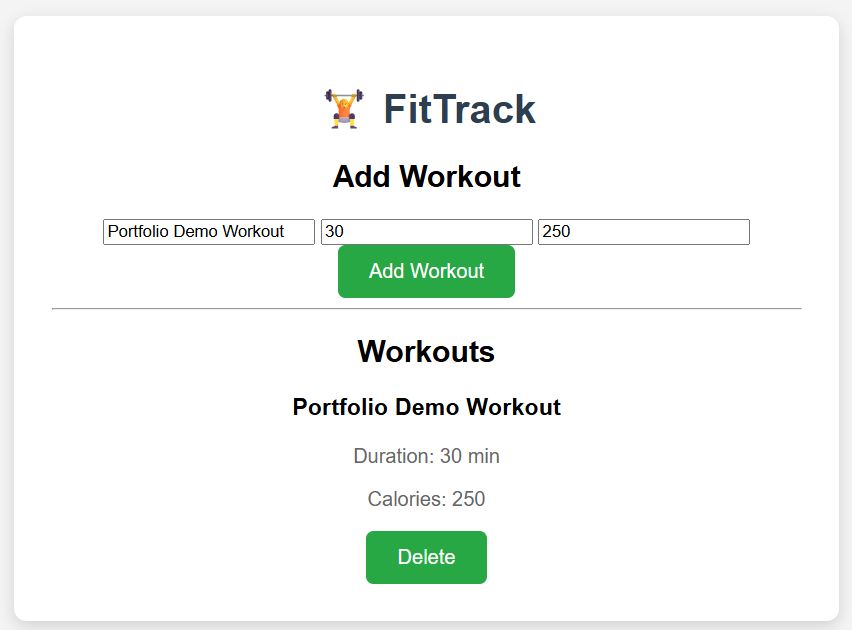

# FitTrack: Dockerization and Multi-Container Deployment

## Project overview

FitTrack is a fitness-tracking web application with a frontend, Node.js
backend, and MongoDB database. This personal portfolio project demonstrates
how to package an application into containers and run its services together
using Docker Compose.

**Project type:** Personal portfolio project  
**Focus:** Docker, Docker Compose, Nginx, Node.js, MongoDB  
**Repository:** https://github.com/ashyT-Cloud/fitness-app-devops

## The problem

Running a multi-component application requires consistent configuration,
service connectivity, database persistence, and a repeatable way to start
and manage the components.

This project packages the application's services into a Docker Compose
deployment to make the environment easier to start, inspect, and maintain.

## Solution and architecture

The deployment contains three services:

- **Frontend:** Serves the web interface through Nginx and exposes port 8080
  on the host by default.
- **Backend:** Runs the Node.js API on port 3000 inside the Compose network.
- **MongoDB:** Stores workout records and uses a named volume for persistent
  database files.

The frontend routes API requests to the backend through the application
configuration. The backend connects to MongoDB using environment variables.

## Implementation highlights

- Defined the application services in Docker Compose.
- Used environment variables for database credentials and configuration.
- Kept the local `.env` file out of Git and provided `.env.example`.
- Added a local Compose override to build frontend and backend images from
  source code.
- Added a MongoDB health check and configured the backend to wait for the
  database health condition.
- Used a named Docker volume for MongoDB data.
- Configured restart policies for the services.
- Validated both production and local Compose configurations.

## Verification results

Verified on October 28, 2026, in the project's EC2 environment:

| Check | Observed result |
| --- | --- |
| Production Compose configuration | Valid |
| Local Compose override | Valid |
| Frontend HTTP request | HTTP 200 |
| Backend health endpoint | HTTP 200, status `UP` |
| MongoDB container | Running and healthy |
| Workouts API (`GET /api/workouts`) | HTTP 200 with a workout record |

These results describe the observed test environment. They are not a claim
of a production load test, security audit, or uptime guarantee.

## Application screenshot

The screenshot below shows FitTrack running with a saved workout record.
It demonstrates the application interface and a successful create-and-display
workflow in the test environment.

## What this demonstrates

This project demonstrates practical experience with containerizing a
multi-service application, configuring service dependencies, managing
runtime configuration, preserving database files with a named volume,
and validating application endpoints.

## Freelance services

I can help developers and small teams with:

- Dockerfiles for existing applications.
- Docker Compose setup for multi-container applications.
- Environment variable and `.env.example` configuration.
- Container startup, networking, and health-check troubleshooting.
- Basic deployment verification and documentation.

**Scope:** Work is agreed before changes are made. Cloud hosting, infrastructure
changes, production hardening, and ongoing support are separate tasks where
required.

## Limitations

This is a personal portfolio project, not paid client work. The verification
checks above confirm basic functionality only; they do not establish
production readiness, comprehensive security, backup recovery, or
high availability.
